[English](README.md) | [한국어](README.ko.md) | 日本語

# Frame Dock

Steam Frame 用の SteamVR オーバーレイです。性能パネル、ブラウザ、色補正、デバイス操作を手首に表示し、ゲームを止めずにその場で使えます。

| 手首を返すとパネルが出て、戻すと消えます | ドックからブラウザを開いて操作する |
| --- | --- |
| 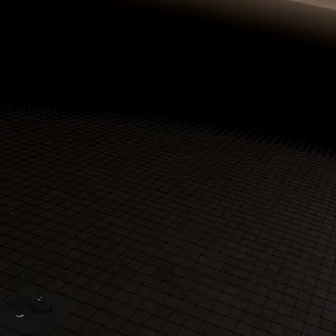 | 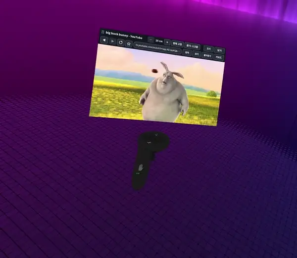 |
| **色補正: プリセットで見えるもの全体の色合いを変えます** | **視線に合わせたシャープ: 視線補正中、シャープにする範囲を色付けして見せます** |
| 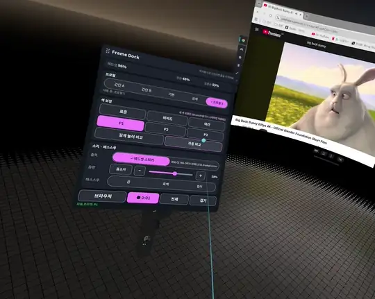 | 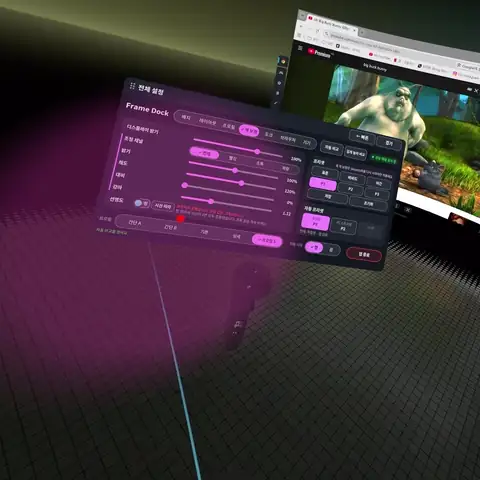 |

## 機能

- **性能パネル**: フレームレート、CPU、GPU、メモリ、電池と残り時間、温度、通信、時計を表示します。組み込みのプロファイル（シンプル A、シンプル B、基本、詳細）を選ぶか、カードを自分で並べられます。操作のカード（色補正、サウンド、パススルー、プロファイル、ブラウザ）も置けて、そのボタンはパネルで直接押せます。
- **ドック**: 反対の手でパネルを指してトリガーを引くと開きます。ゲームを離れずに、プロファイル、色補正のプリセット、サウンド、パススルーを切り替えたり、ブラウザを開いたりできます。
- **ブラウザ**: 手首に表示する本物の Google Chrome です。専用の VR キーボード（英字、ハングル、記号）と翻訳があります。パネルを閉じても音は流れ続け、性能パネルの下に出る操作バーで再生・停止・10 秒の送り戻しができます。
- **色補正**: 見えるものすべての明るさ、彩度、コントラスト、ガンマ、シャープネスを調整します。プリセットと補正前後の比較があります。シャープにする場所を視線に合わせることもできます（アイトラッキング）。隣の**補正**は 9 点を見る視線補正です。補正中は各点でシャープにする範囲を今の補正で色付けするので、2 回目の補正で 1 回目がどれだけ合っているかが見えます。
- **デバイス**: サウンドの出力機器と音量、パススルー（オフ・モノクロ・カラー）を切り替えます。

表示は日本語・英語・韓国語に対応し、Steam の言語に合わせます。

<details>
<summary>ほかの画面</summary>

| 基本 | 詳細 |
| --- | --- |
| 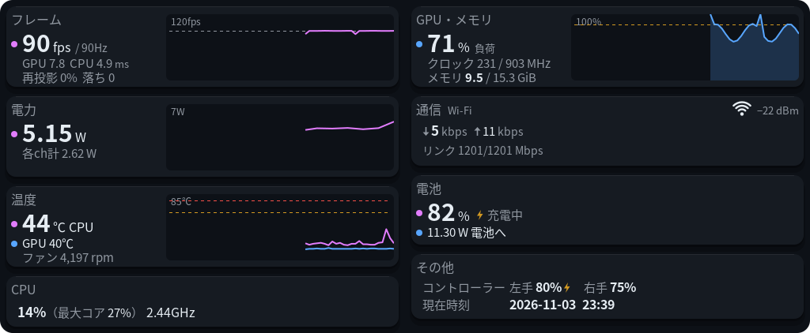 | 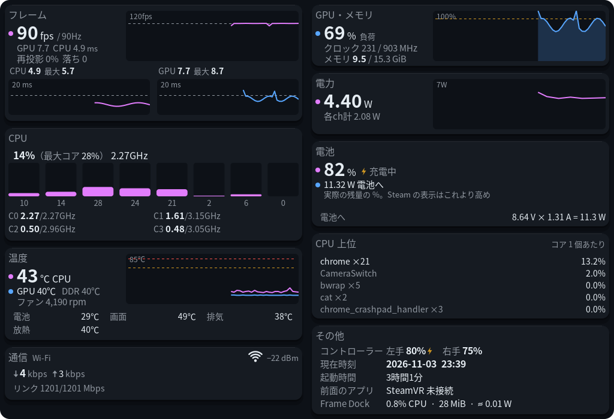 |
| **シンプル A** | **シンプル B** |
| 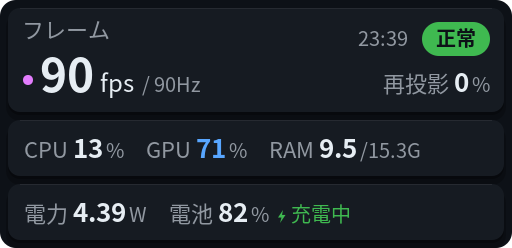 | 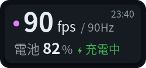 |
| **ドック** | **VR キーボード** |
| 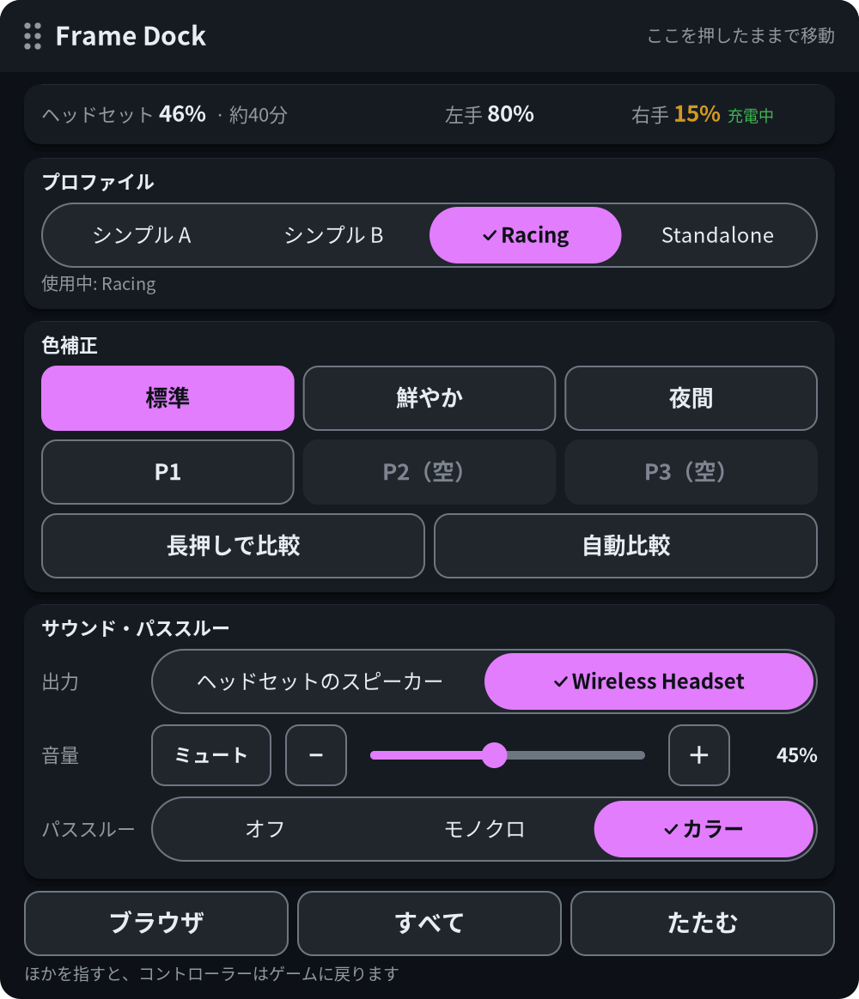 | 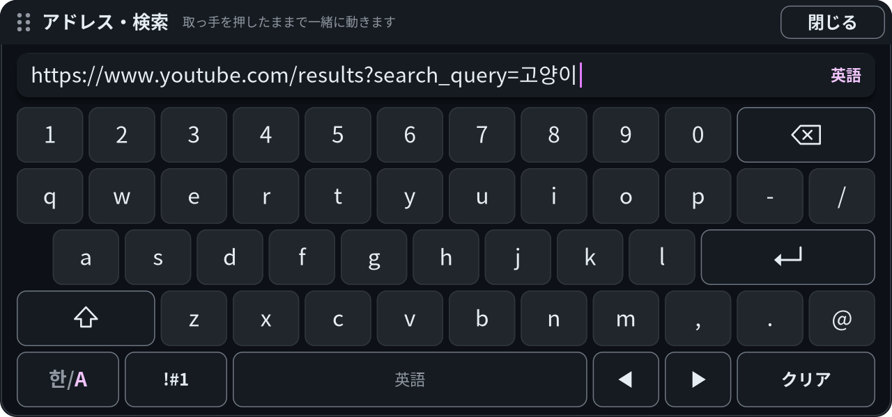 |
| **色補正の設定** | **初回の案内** |
| 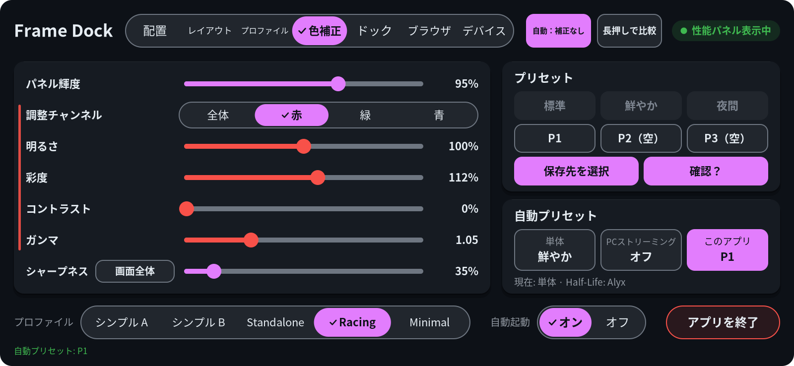 | 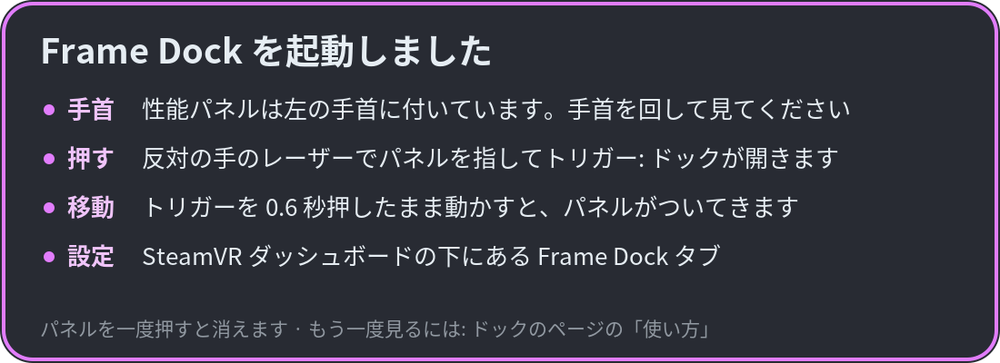 |

</details>

## 必要なもの

- SteamOS と SteamVR が入った Steam Frame
- ヘッドセットのターミナル: Konsole（Steam の設定 → システムで開発者モードをオン）または SSH
- ブラウザを使うには Flathub の Google Chrome（`flatpak install flathub com.google.Chrome`）
- モノクロ・カラーのパススルーを使うには [Arcturus Vision Camera](https://store.steampowered.com/app/4103250/) と、動いている Camera Switch
- 任意: 手首のパネルとドックの録画ボタンを使うには、`~/.local/bin` に入った framecorder（Steam Frame 用の別の録画プログラム）。なければボタンは出ません

sudo は要りません。すべてホームフォルダーに入ります。

## インストール

[Releases](https://github.com/guix8/framedock/releases) から `framedock-0.1.0-steamframe-aarch64.tar.gz` をヘッドセットにダウンロードし、次を実行します。

```sh
tar -xzf framedock-0.1.0-steamframe-aarch64.tar.gz
sh framedock/contrib/install.sh
```

以後は SteamVR と一緒に Frame Dock も起動します。更新するときも、新しいリリースで同じ手順を繰り返します。

最初のインストールでは色補正はオフです。オンにするには `~/.local/bin/framedockctl enable` を実行します。SteamVR が再起動するので、先にゲームを終了してください。

Frame Perf Overlay や FrameColor が入っている場合は、置き換える前に確認します。設定はそのまま引き継がれます。

## 使い方

- **見る**: パネルは左手の手首にあります。手首を返して見ます。
- **ドックを開く**: 反対の手でパネルを指してトリガーを引きます。
- **パネルを動かす**: 性能パネルはトリガーを 0.6 秒押したまま動かします。ドックとブラウザは上のバーをつかんで動かします。
- **設定**: SteamVR ダッシュボードの **Frame Dock** タブか、ドックの**すべて**から開きます。

## アンインストール

```sh
sh framedock/contrib/uninstall.sh
```

設定は残します。設定まで消すコマンドはスクリプトが表示します。

## 知っておくとよいこと

- ゲーム中はグリップではなく**トリガー**でパネルをつかんでください。グリップをゲームが使っていることがあります。
- レーザーが違う手から出たら、使いたい手のトリガーを一度引きます。
- ブラウザで **Google のログイン**を断られることがあります。ブラウザの設定ページで**実行方式**を**ウィンドウ**にしてログインし、**ウィンドウなし**に戻してください。
- DRM のある動画（Netflix など）は黒くなることがあります。
- VR キーボードに日本語のかな入力はありません。
- 色補正で問題が起きたら、SSH で `framedockctl disable` を実行します。
- Frame Dock はネットワークに何も送りません。利用統計も更新の確認もありません。ブラウザはふつうのブラウザと同じようにインターネットにつながります。

<details>
<summary>ソースからビルド</summary>

CMake、Ninja、C++17 のコンパイラーと、cairo、freetype2、vulkan、libnl-genl-3.0、libturbojpeg、libpulse、libsystemd、libcurl の開発用ファイルが要ります。色補正のレイヤーには Meson と glslangValidator が要ります。ビルドでは SteamVR の `/opt/steamvr/bin/linuxarm64/libopenvr_api.so` をリンクします。

SteamOS にはコンパイラーがないので、glibc がホストより新しくない [distrobox](https://distrobox.it/) のコンテナー（例: Ubuntu 24.04）でビルドし、作ったリリースのファイルをホストにインストールします。

```sh
cmake -G Ninja -S . -B build && cmake --build build && ctest --test-dir build
sh contrib/package.sh 0.1.0    # dist/framedock-0.1.0-steamframe-aarch64.tar.gz を作ります
```

ヘッドセットからコピーした sysroot を使って PC（Linux または WSL）でビルドし、SSH で送ることもできます。[contrib/cross/README.md](contrib/cross/README.md)（韓国語）を見てください。

</details>

## クレジットとライセンス

MIT License です（[LICENSE](LICENSE)）。Frame Dock は次のプロジェクトをもとに作りました。各プロジェクトの表示は [THIRD_PARTY_LICENSES.ja.md](THIRD_PARTY_LICENSES.ja.md) にあります。

| プロジェクト | ライセンス | 使っている所 |
| --- | --- | --- |
| [Frame Perf Overlay](https://github.com/sasaken1102r/frame-perf-overlay) — sasaken1102r、finaea さんの貢献 | MIT | 性能パネルとダッシュボードタブ |
| [FrameColor](https://github.com/beko-kerbecotton/framecolor) — beko-kerbecotton、brugr さんの貢献 | MIT | 色補正。このリポジトリは FrameColor のフォークから始まりました |
| [Frametop](https://github.com/Frametop/frametop) — DeeJanuz | MIT | ゲーム中のレーザー入力、VR キーボードの設計 |
| [frameeyeosc](https://github.com/sasaken1102r/frameeyeosc) — konsti219、sasaken1102r | MIT | FrameColor の元のダッシュボードのコード、視線の補正となめらかにする規則 |
| [vkBasalt](https://github.com/DadSchoorse/vkBasalt) — Georg Lehmann | zlib | 色補正の Vulkan レイヤー |
| AMD FidelityFX CAS | MIT | シャープネス |
| [OpenVR](https://github.com/ValveSoftware/openvr) | BSD-3-Clause | OpenVR の API |

冒頭のブラウザの動画は [Big Buck Bunny](https://peach.blender.org/)（© Blender Foundation、CC BY 3.0）です。

AI のコーディング支援ツール Claude Code の助けを借りて作りました。

非公式のプロジェクトで、Valve とは関係ありません。Steam、Steam Frame、SteamVR は Valve Corporation の商標で、Google Chrome は Google LLC の商標です。無保証です。自己責任でお使いください。
