[English](README.md) | 한국어 | [日本語](README.ja.md)

# Frame Dock

Steam Frame용 SteamVR 오버레이입니다. 성능 패널, 브라우저, 색 보정, 기기 조작을 손목에 띄우고, 게임을 멈추지 않은 채 바로 쓸 수 있습니다.

| 손목을 돌리면 패널이 나타나고 사라집니다 | 도크에서 브라우저 열고 제어하기 |
| --- | --- |
| 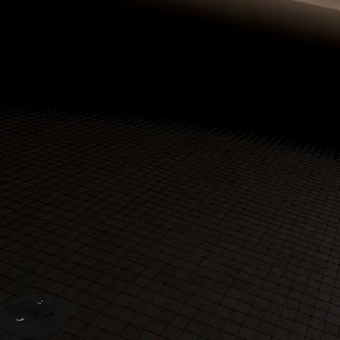 | 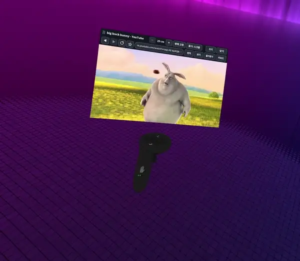 |
| **색 보정: 프리셋으로 보이는 화면 전체의 색감을 바꿉니다** | **시선 따라 샤픈: 시선 보정 중 샤픈 영역을 색칠해 보여 줍니다** |
| 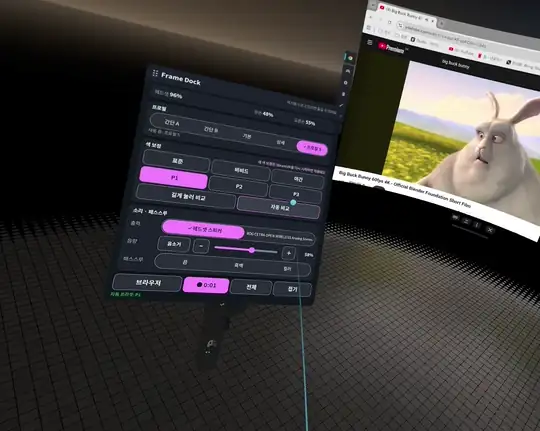 | 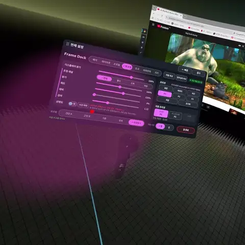 |

## 기능

- **성능 패널**: 프레임 수, CPU, GPU, 메모리, 배터리와 남은 시간, 온도, 네트워크, 시계를 보여 줍니다. 기본 제공 프로필(간단 A, 간단 B, 기본, 상세)을 고르거나 카드를 직접 배치할 수 있습니다. 조작 카드(색 보정, 소리, 패스스루, 프로필, 브라우저)도 넣을 수 있고, 그 버튼은 패널에서 바로 누릅니다.
- **도크**: 다른 손으로 패널을 가리키고 트리거를 당기면 열립니다. 게임을 벗어나지 않고 프로필, 색 보정 프리셋, 소리, 패스스루를 바꾸거나 브라우저를 엽니다.
- **브라우저**: 손목에 띄우는 실제 Google Chrome입니다. 전용 VR 키보드(한글, 영문, 기호)와 번역 기능이 있습니다. 패널을 닫아도 소리는 계속 나오고, 성능 패널 아래에 붙는 조작 줄로 재생·멈춤·10초 앞뒤 이동을 할 수 있습니다.
- **색 보정**: 눈에 보이는 모든 화면의 밝기, 채도, 대비, 감마, 선명도를 조절합니다. 프리셋과 보정 전후 비교가 있습니다. 선명하게 하는 곳이 시선을 따라가게 할 수 있습니다(시선 추적). 옆의 **보정**은 점 9개를 보는 시선 보정입니다. 보정하는 동안 각 점에서 샤픈 영역을 지금 쓰는 보정으로 색칠해서, 두 번째 보정에서는 첫 보정이 얼마나 맞는지 바로 보입니다.
- **기기**: 소리 출력 장치와 음량, 패스스루(끔·흑백·컬러)를 바꿉니다.

화면은 한국어, 영어, 일본어를 지원하며 Steam의 언어를 따라갑니다.

<details>
<summary>화면 더 보기</summary>

| 기본 | 상세 |
| --- | --- |
| 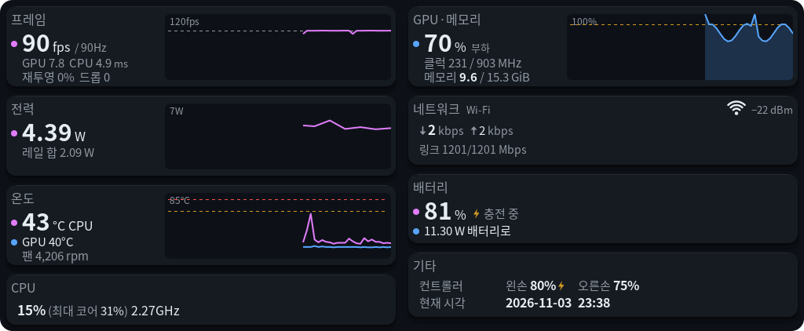 | 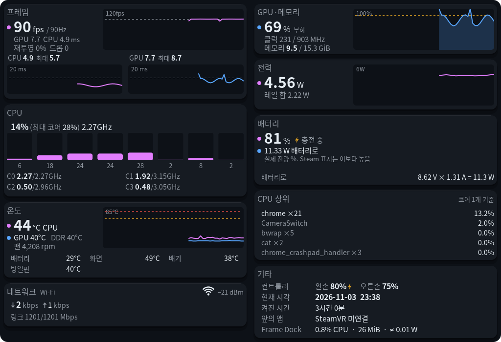 |
| **간단 A** | **간단 B** |
| 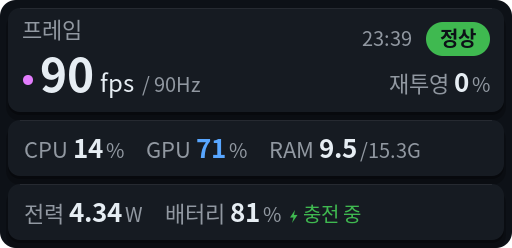 | 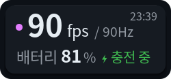 |
| **도크** | **VR 키보드** |
| 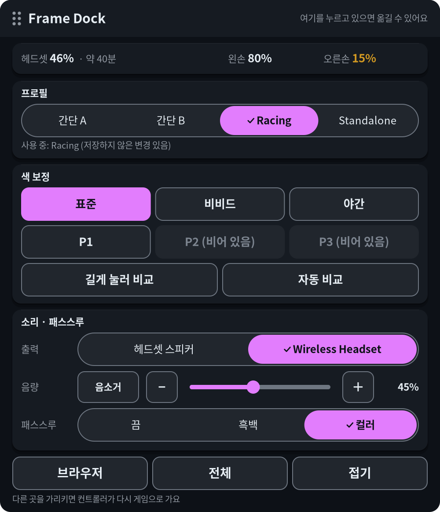 | 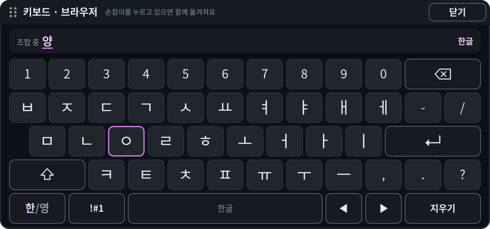 |
| **색 보정 설정** | **첫 실행 안내** |
| 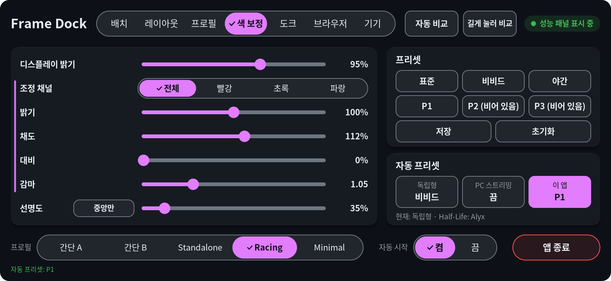 | 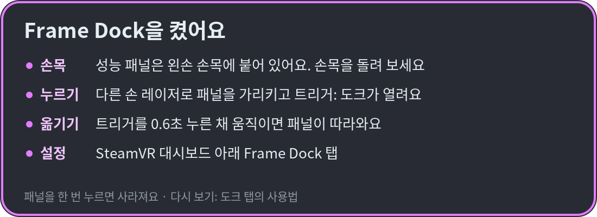 |

</details>

## 필요한 것

- SteamOS와 SteamVR이 있는 Steam Frame
- 헤드셋의 터미널: Konsole(Steam 설정 → 시스템에서 개발자 모드를 켭니다) 또는 SSH
- 브라우저를 쓰려면 Flathub의 Google Chrome(`flatpak install flathub com.google.Chrome`)
- 흑백·컬러 패스스루를 쓰려면 [Arcturus Vision Camera](https://store.steampowered.com/app/4103250/)와, 실행 중인 Camera Switch
- 선택: 손목 패널과 도크의 녹화 버튼을 쓰려면 `~/.local/bin`에 설치된 framecorder(Steam Frame용 별도 녹화 프로그램). 없으면 버튼이 나타나지 않습니다

sudo는 필요 없습니다. 모든 파일은 홈 폴더에 설치됩니다.

## 설치

[Releases](https://github.com/guix8/framedock/releases)에서 `framedock-0.1.0-steamframe-aarch64.tar.gz`를 헤드셋으로 받은 뒤 다음을 실행합니다.

```sh
tar -xzf framedock-0.1.0-steamframe-aarch64.tar.gz
sh framedock/contrib/install.sh
```

이후에는 SteamVR을 켤 때 Frame Dock도 함께 켜집니다. 업데이트할 때도 새 릴리스로 같은 과정을 반복하면 됩니다.

처음 설치하면 색 보정은 꺼져 있습니다. 켜려면 `~/.local/bin/framedockctl enable`을 실행합니다. 이때 SteamVR이 다시 시작되므로 게임을 먼저 종료하십시오.

Frame Perf Overlay나 FrameColor가 설치되어 있으면 설치 스크립트가 교체 여부를 먼저 묻습니다. 기존 설정은 그대로 이어집니다.

## 사용법

- **보기**: 패널은 왼손 손목에 붙어 있습니다. 손목을 돌려 확인합니다.
- **도크 열기**: 다른 손으로 패널을 가리키고 트리거를 당깁니다.
- **패널 옮기기**: 성능 패널은 트리거를 0.6초 누른 채 움직입니다. 도크와 브라우저는 위쪽 막대를 잡고 옮깁니다.
- **설정**: SteamVR 대시보드의 **Frame Dock** 탭, 또는 도크의 **전체** 버튼에서 엽니다.

## 제거

```sh
sh framedock/contrib/uninstall.sh
```

설정은 남겨 둡니다. 설정까지 지우는 명령은 스크립트가 알려 줍니다.

## 선택: PC 도우미 (렌더 크기)

프레임 카드에 게임이 한쪽 눈을 그리는 크기(예: `2400×2400`)가 나옵니다. 헤드셋에서 도는 게임은 색 보정 레이어가 알려 줍니다(`framedockctl enable`로 켭니다). PC에서 스트리밍하는 게임은 PC의 SteamVR만 이 크기를 알기 때문에, 작은 Windows 도우미가 SteamVR 로그에서 읽고 Frame Dock이 스트리밍 중에 물어봅니다(이때 크기 옆에 **PC**가 붙습니다). 도우미가 없으면 아무것도 나오지 않습니다.

`powershell -ExecutionPolicy Bypass -File pc-helper\build.ps1`로 빌드합니다(Windows에 들어 있는 C# 컴파일러, SDK 불필요). 그다음 PC에서:

```bat
framedock-pc.exe --install      :: %LOCALAPPDATA%\FrameDock에 복사, 로그인할 때와 지금 시작
framedock-pc.exe --uninstall    :: 멈추고 지움
```

LAN의 TCP 27463 포트에서 `GET /render`에만 답하며 읽기 전용입니다. 게임의 앱 키와 렌더 크기 말고는 아무것도 알려 주지 않습니다. Windows가 개인 네트워크에서 허용할지 물을 수 있습니다. 허용해야 헤드셋이 접속할 수 있습니다.

## 알아 두면 좋은 점

- 게임 중에는 그립 대신 **트리거**로 패널을 잡으십시오. 그립을 게임이 가져가는 경우가 있습니다.
- 레이저가 원하지 않는 손에서 나오면, 쓰려는 손의 트리거를 한 번 당깁니다.
- 브라우저에서 **Google 로그인**이 거부될 수 있습니다. 브라우저 설정 페이지에서 **실행 방식**을 **창**으로 바꿔 로그인한 뒤 **창 없이**로 되돌리십시오.
- DRM이 걸린 영상(Netflix 등)은 검게 나올 수 있습니다.
- 색 보정 때문에 문제가 생기면 SSH로 `framedockctl disable`을 실행합니다.
- Frame Dock은 인터넷으로 아무것도 보내지 않습니다. 사용 통계도, 업데이트 확인도 없습니다. PC 스트리밍 중에는 LAN의 PC에 렌더 크기를 물어봅니다(27463 포트, 선택 사항인 PC 도우미). 브라우저는 일반 브라우저처럼 인터넷에 연결됩니다.

<details>
<summary>소스에서 빌드</summary>

CMake, Ninja, C++17 컴파일러와 cairo, freetype2, vulkan, libnl-genl-3.0, libturbojpeg, libpulse, libsystemd, libcurl 개발 파일이 필요합니다. 색 보정 레이어에는 Meson과 glslangValidator가 필요합니다. 빌드할 때 SteamVR의 `/opt/steamvr/bin/linuxarm64/libopenvr_api.so`를 링크합니다.

SteamOS에는 컴파일러가 없으므로, glibc가 호스트보다 새롭지 않은 [distrobox](https://distrobox.it/) 컨테이너(예: Ubuntu 24.04)에서 빌드하고, 만든 릴리스 파일을 호스트에 설치합니다.

```sh
cmake -G Ninja -S . -B build && cmake --build build && ctest --test-dir build
sh contrib/package.sh 0.1.0    # dist/framedock-0.1.0-steamframe-aarch64.tar.gz 를 만듭니다
```

헤드셋에서 복사한 sysroot로 PC(Linux 또는 WSL)에서 빌드하고 SSH로 옮길 수도 있습니다. [contrib/cross/README.md](contrib/cross/README.md)를 보세요.

</details>

## 출처와 라이선스

MIT License입니다([LICENSE](LICENSE)). Frame Dock은 아래 프로젝트를 바탕으로 만들었으며, 각 프로젝트의 고지는 [THIRD_PARTY_LICENSES.md](THIRD_PARTY_LICENSES.md)에 있습니다.

| 프로젝트 | 라이선스 | 쓰인 곳 |
| --- | --- | --- |
| [Frame Perf Overlay](https://github.com/sasaken1102r/frame-perf-overlay) — sasaken1102r, finaea 기여 | MIT | 성능 패널과 대시보드 탭 |
| [FrameColor](https://github.com/beko-kerbecotton/framecolor) — beko-kerbecotton, brugr 기여 | MIT | 색 보정. 이 저장소는 FrameColor의 포크에서 시작했습니다 |
| [Frametop](https://github.com/Frametop/frametop) — DeeJanuz | MIT | 게임 중 레이저 입력, VR 키보드 설계 |
| [frameeyeosc](https://github.com/sasaken1102r/frameeyeosc) — konsti219, sasaken1102r | MIT | FrameColor의 원래 대시보드 코드, 시선 보정·시선 다듬기 규칙 |
| [vkBasalt](https://github.com/DadSchoorse/vkBasalt) — Georg Lehmann | zlib | 색 보정용 Vulkan 레이어 |
| AMD FidelityFX CAS | MIT | 선명도 처리 |
| [OpenVR](https://github.com/ValveSoftware/openvr) | BSD-3-Clause | OpenVR API |

맨 위 브라우저 움짤에 나오는 영상은 [Big Buck Bunny](https://peach.blender.org/)(© Blender Foundation, CC BY 3.0)입니다.

AI 코딩 도우미 Claude Code의 도움을 받아 만들었습니다.

비공식 프로젝트이며 Valve와 관계가 없습니다. Steam, Steam Frame, SteamVR은 Valve Corporation의 상표이고, Google Chrome은 Google LLC의 상표입니다. 보증은 없으며, 사용에 따른 책임은 사용자에게 있습니다.
