English | [한국어](README.ko.md) | [日本語](README.ja.md)

# Frame Dock

A SteamVR overlay for the Steam Frame. It puts a performance panel, a browser, colour correction and quick device controls on your wrist, and you can use all of them in the middle of a game without pausing it.

| Turn your wrist to show or hide the panel | Open and control the browser from the Dock |
| --- | --- |
| 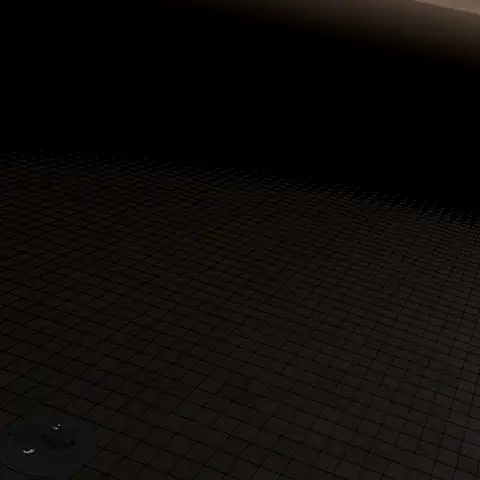 | 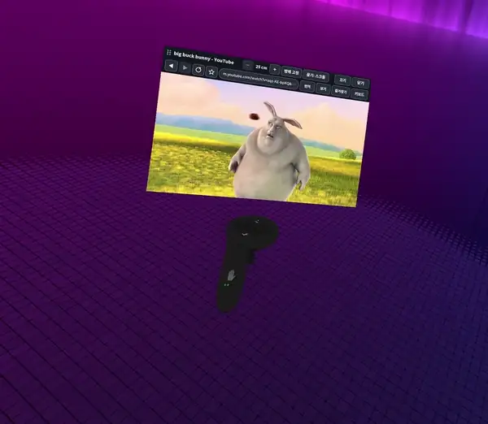 |
| **Colour correction: change the look of everything you see with presets** | **Sharpening that follows your gaze: the gaze fit, with the sharpened area tinted** |
| 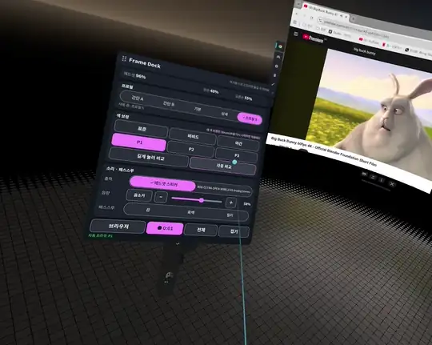 | 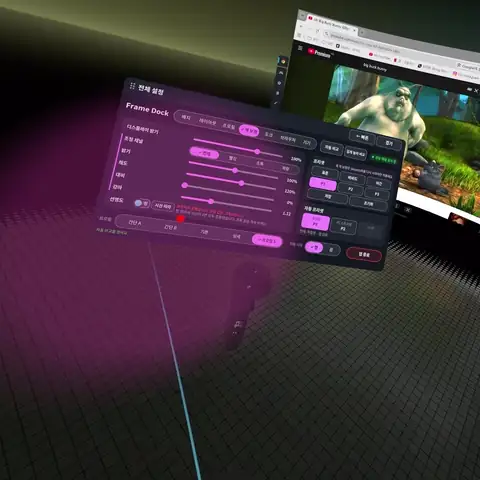 |

## Features

- **Performance panel**: frame rate, CPU, GPU, RAM, battery and time left, temperatures, network and the clock. Pick a built-in profile (Simple A, Simple B, Basic, Detailed) or arrange the cards yourself. Control cards (colour presets, sound, passthrough, profiles, browser) can go on it too, and you press their buttons right on the panel.
- **Dock**: point at the panel with your other hand and pull the trigger. Switch profiles, colour presets, sound and passthrough, or open the browser, all without leaving the game.
- **Browser**: a real Google Chrome on your wrist, with its own VR keyboard (English, Korean, symbols) and translation. Close the panel and the sound keeps playing; play, pause and jump 10 s from a strip under the performance panel.
- **Colour**: brightness, saturation, contrast, gamma and sharpness for everything you see, with presets and a before/after compare. Sharpening can follow your gaze (eye tracking); **Fit** next to it runs a 9-dot gaze fit, tinting the sharpened area on each dot (drawn with the fit in use, so a second fit shows how well the first one matches).
- **Device**: sound output and volume, passthrough off, mono or colour.

The UI is in English, Korean and Japanese and follows Steam's language.

<details>
<summary>More screenshots</summary>

| Basic | Detailed |
| --- | --- |
| 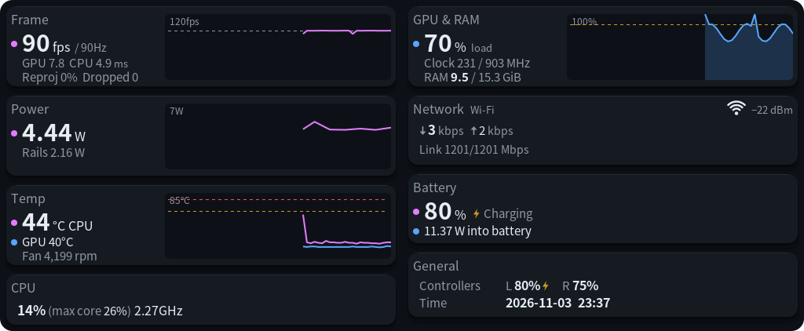 | 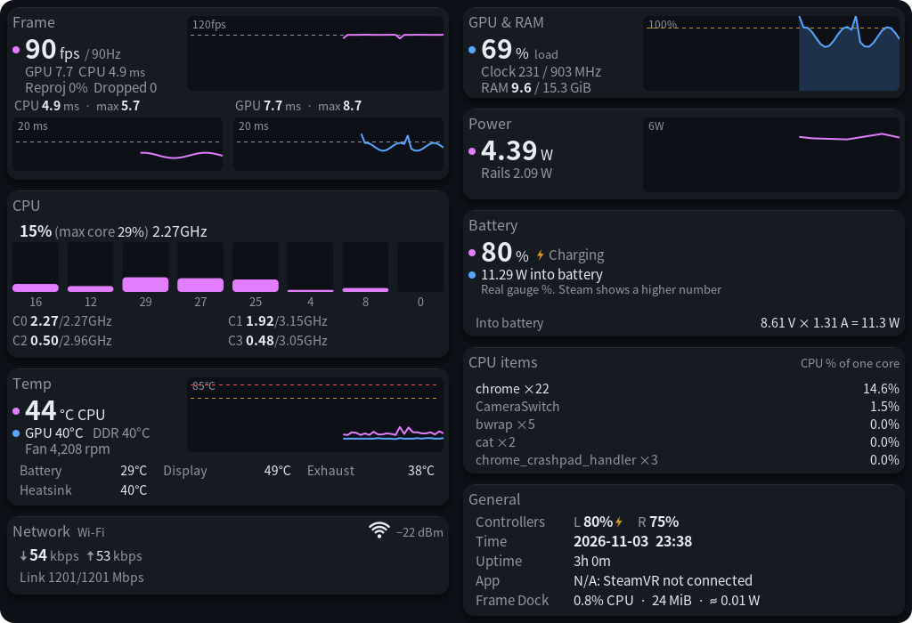 |
| **Simple A** | **Simple B** |
| 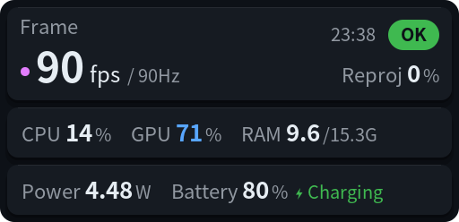 | 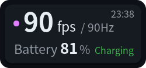 |
| **Dock** | **VR keyboard** |
| 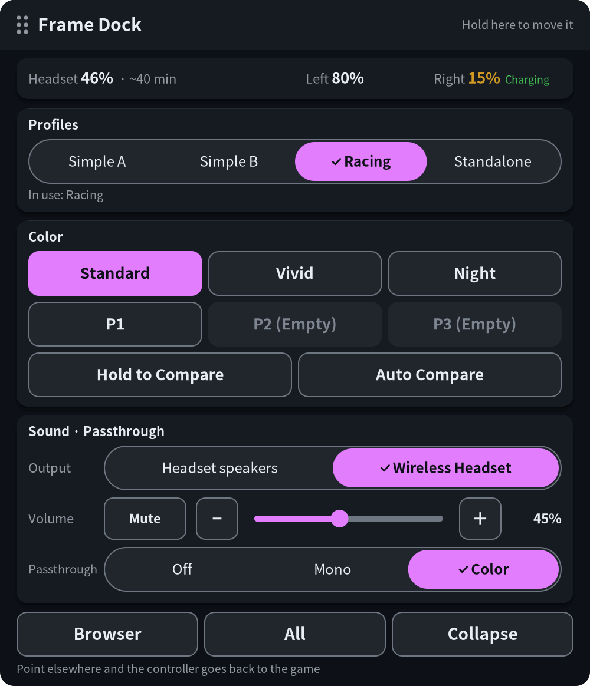 | 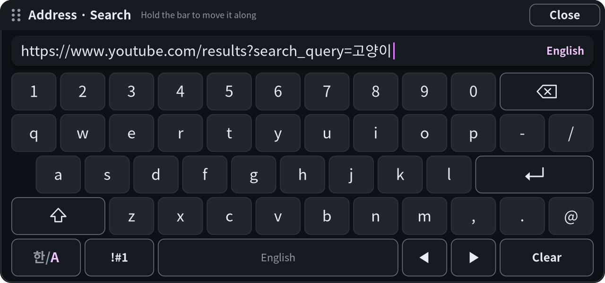 |
| **Colour settings** | **First-run guide** |
| 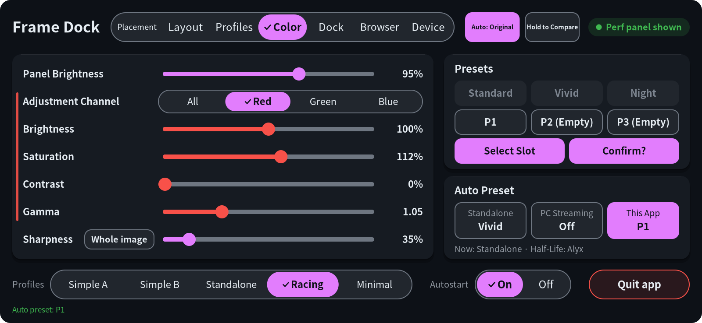 | 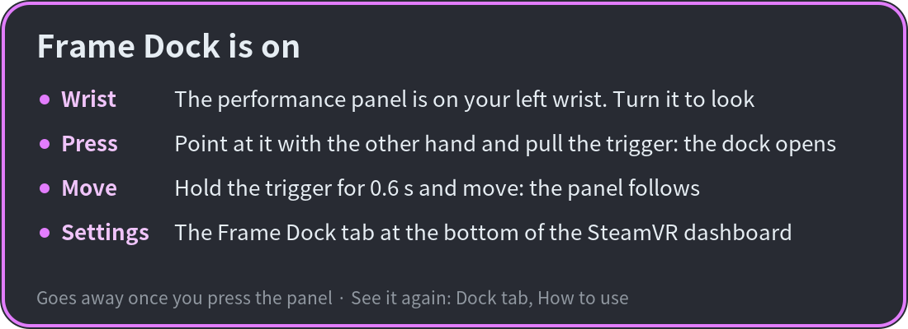 |

</details>

## Requirements

- A Steam Frame with SteamOS and SteamVR
- A terminal on the headset: Konsole (turn on Developer Mode in Steam Settings → System) or SSH
- For the browser: Google Chrome from Flathub (`flatpak install flathub com.google.Chrome`)
- For mono and colour passthrough: [Arcturus Vision Camera](https://store.steampowered.com/app/4103250/) with its Camera Switch running
- Optional, for the Record control on the wrist panel and the Dock: [framecorder](https://github.com/coah80/framecorder) (a separate recorder for the Steam Frame) installed in `~/.local/bin`. Without it the control doesn't appear. While framecorder's own tab runs, Record goes through it, and with its clips on the control also offers Clip now (needs a framecorder with its tab's `command.json`: its dev build for now)

No sudo is needed. Everything goes into your home folder.

## Install

Download `framedock-0.1.1-steamframe-aarch64.tar.gz` from [Releases](https://github.com/guix8/framedock/releases) to the headset, then run:

```sh
tar -xzf framedock-0.1.1-steamframe-aarch64.tar.gz
sh framedock/contrib/install.sh
```

Frame Dock starts with SteamVR from then on. To update, do the same with the new release.

The colour correction is off after the first install. To turn it on, run `~/.local/bin/framedockctl enable` (this restarts SteamVR, so close your game first).

If Frame Perf Overlay or FrameColor is installed, the installer asks before replacing it. Your settings carry over.

## How to use

- **Look**: the panel sits on your left wrist. Turn your wrist.
- **Open the Dock**: point at the panel with the other hand and pull the trigger.
- **Move a panel**: hold the trigger on the performance panel for 0.6 s and move. Move the Dock or the browser by its top bar.
- **Settings**: the **Frame Dock** tab in the SteamVR dashboard, or **All** in the Dock.

## Uninstall

```sh
sh framedock/contrib/uninstall.sh
```

Your settings are kept; the script prints the command to delete them.

## Optional: PC helper (render size)

The Frame card shows the size the game renders each eye at, for example `2400×2400`. For a game on the headset this comes from the colour layer (turn it on with `framedockctl enable`). For a game streamed from a PC only SteamVR on the PC knows it, so a small Windows helper reads it from SteamVR's log and Frame Dock asks it during the stream (the size then shows with **PC**). Without the helper nothing is shown there.

Build it with `powershell -ExecutionPolicy Bypass -File pc-helper\build.ps1` (the C# compiler that comes with Windows, no SDK), then on the PC:

```bat
framedock-pc.exe --install      :: copies itself to %LOCALAPPDATA%\FrameDock, starts at sign-in and now
framedock-pc.exe --uninstall    :: stops it and removes it
```

It answers only `GET /render` on TCP port 27463 on your LAN, read-only: the game's app key and render size, nothing else. Windows may ask whether to allow it on private networks; allow it there, or the headset can't reach it.

## Good to know

- During a game, use the **trigger**, not the grip, to grab panels. Some games keep the grip to themselves.
- If the laser comes from the wrong hand, pull the trigger once on the hand you want.
- **Google sign-in** may be refused in the browser. On the Browser settings page, set **Runs as** to **Window**, sign in, then set it back to **No window**.
- DRM video (Netflix and similar) may show black.
- If the colour correction causes trouble, run `framedockctl disable` over SSH.
- Frame Dock sends no telemetry. While the settings tab is open it asks GitHub at most once a day for the latest version number and says so if there is a newer one; it never downloads anything. Turn it off with **Check for updates** at the bottom of the tab. During a PC stream it asks the PC on your LAN for the render size (port 27463, the optional PC helper). The browser goes online like any browser.

<details>
<summary>Build from source</summary>

You need CMake, Ninja, a C++17 compiler, and the development files for cairo, freetype2, vulkan, libnl-genl-3.0, libturbojpeg, libpulse, libsystemd and libcurl, plus Meson and glslangValidator for the colour layer. The build links SteamVR's `libopenvr_api.so` from `/opt/steamvr/bin/linuxarm64`.

SteamOS has no compilers, so build in a [distrobox](https://distrobox.it/) container whose glibc is not newer than the host's (for example Ubuntu 24.04), then install the packaged release on the host:

```sh
cmake -G Ninja -S . -B build && cmake --build build && ctest --test-dir build
sh contrib/package.sh 0.1.1    # makes dist/framedock-0.1.1-steamframe-aarch64.tar.gz
```

You can also build on a PC (Linux or WSL) against a sysroot copied from the headset and copy the result over SSH: see [contrib/cross/README.md](contrib/cross/README.md) (in Korean).

</details>

## Credits and license

MIT License ([LICENSE](LICENSE)). Frame Dock is built on these projects; their notices are in [THIRD_PARTY_LICENSES.md](THIRD_PARTY_LICENSES.md).

| Project | License | Used for |
| --- | --- | --- |
| [Frame Perf Overlay](https://github.com/sasaken1102r/frame-perf-overlay) by sasaken1102r, with finaea | MIT | The performance panel and dashboard tab |
| [FrameColor](https://github.com/beko-kerbecotton/framecolor) by beko-kerbecotton, with brugr | MIT | Colour correction; this repository started as its fork |
| [Frametop](https://github.com/Frametop/frametop) by DeeJanuz | MIT | Laser input during games; the VR keyboard's design |
| [frameeyeosc](https://github.com/sasaken1102r/frameeyeosc) by konsti219 and sasaken1102r | MIT | FrameColor's original dashboard code; the gaze smoothing and gaze fit rules |
| [vkBasalt](https://github.com/DadSchoorse/vkBasalt) by Georg Lehmann | zlib | The Vulkan layer for colour correction |
| AMD FidelityFX CAS | MIT | Sharpening |
| [OpenVR](https://github.com/ValveSoftware/openvr) | BSD-3-Clause | The OpenVR API |

The browser clip at the top plays [Big Buck Bunny](https://peach.blender.org/) (© Blender Foundation, CC BY 3.0).

Made with the help of Claude Code, an AI coding assistant.

Unofficial project, not affiliated with Valve. Steam, Steam Frame and SteamVR are trademarks of Valve Corporation. Google Chrome is a trademark of Google LLC. No warranty; use at your own risk.
